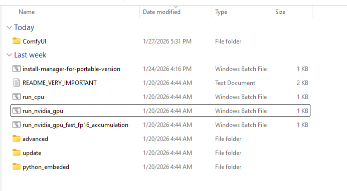
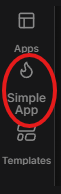

# Accessing SAUS

[Return to User Guide](USER_GUIDE.md#accessing-the-interface)

## 1. Direct Link (ComfyUI Portable)
When you start ComfyUI Portable, you will normally access it as you do with ComfyUI.



In the command window, you will see that ComfyUI-SAUS is downloading/updating the apps and initializing. 


ComfyUI will open normally. You can access SAUS by adding `/saus` to the end of the ComfyUI address:
```
http://127.0.0.1:8188/saus
```


## 2. From ComfyUI graph

<table>
  <tr>
    <td valign="middle"></td>
    <td>Start ComfyUI as indicated before. On the <b>left toolbar</b> (the icon rail along the left edge) you will see the <b>Simple App</b> icon &mdash; a flame, next to the App Builder's hammer. Click it to open the interface.</td>
  </tr>
</table>

## 3. From Runpod
If you deployed the **ComfyUI latest - SAUS - KN** template, access via port 7771 or through the ComfyUI interface.

When the pod starts, Runpod automatically opens the panel, where you just need to click on port 7771:


During installation it may take a while. In second and subsequent runs it will take much shorter. Nevertheless, it is always good to check on the logs to see where the process is:


And in case that you navigate away, just click over the pod you have created and the panel will show up again:


[Return to User Guide](USER_GUIDE.md#accessing-the-interface)
