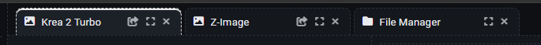

# App Browsing

[Return to User Guide](USER_GUIDE.md)

The browsing page has an **icon rail** on the far left and a **workspace** with tabs on the right. There is no header or footer: the SAUS logo sits at the top of the rail, and the project links plus the version live in the **Settings** tab.

## The rail

<table>
  <tr>
    <td valign="middle"></td>
    <td>On the top of the rail you reach the three app sections; at the bottom sit the tools. <b>Click</b> a section to open its panel with its sub-categories, and <b>click the same icon again</b> to close it.</td>
  </tr>
</table>

- **AI Image**: Create AI images from text, other images, or edit existing images, using the latest models available in ComfyUI (Qwen Image 2.1, Krea 2, etc.)
- **AI Video**: Create AI videos from text or other images, with the latest video generation models available in ComfyUI (Minimax H3, LTX-2.5, etc)
- **Other**: Image and video tools (remove background, upscaling, etc)

In the bottom part, you can find:

- **ComfyUI**: opens ComfyUI in a new window.
- **Files**: the [File Manager](FILE_MANAGER.md), as a tab in the workspace.
- **Guide**: this user guide, in a new window.
- **Console**: the ComfyUI console/log feed, as a tab in the workspace.
- **Settings**: theme picker, installed SAUS version and Social Media links.

## The panel

The side panel is divided in a header, where you can search and filter apps and quickly reach your favorite apps, and the tree, which displays the available SAUS apps per sub-category.

### The panel head

- **Search** — filters apps by name, description, category or tag.
- **Tags** — unfolds the tag chips (base / distilled-fast / quantized, FLUX / SDXL / QWEN / WAN, image-to-image / inpainting / (re-)styling...). The little number next to the button counts the active search + tag filters.
- **Favorites** — The list of favorites, per category, appears once you add favorites (the **☆** on an app row) in the tree.

## The tree

Below them **section name** (AI Image / AI Video / Other) the different subcategories, which unfold into the SAUS apps:

1. **Subcategory** (text-to-image, image-to-image (editing), image-to-image (reference), text-to-video, image-to-video, video-to-video, tools...). The number next to it is how many apps it holds.
2. **Apps**: click a subcategory and its rows unfold right there.

## App rows

Each app is a row with a **thumbnail**, its **name**, a status dot, a **☆** and a **(i)**.

Clicking over the **thumbnail** or the **name** opens the app in the workspace on the right of your screen. You can load several different apps on the workspace.

**Status dot** indicates whether every version of the app has the models it needs: 
- green = every version/variant of the app has all of its models. Choose your version (Turbo, 4B/9B...) without restrictions.
- orange = at least one variant is complete (but not all variants). If one version is missing a model (e.g. the Turbo Lora), this will not be active, but you can still run the other versions.
- red = no variant is complete
- grey = still checking

In addition to the **status dot**, a tooltip when hovering the app will indicate if models are needed or not.

In every case, click **(i)** to see the details and [install](MODELS.md) the missing models.

**☆** marks the app as a favorite; favorites then appear in the panel head.

## Opening apps: tabs

When clicking in an app this is loaded in the **workspace** as a tab. If other apps (or the File Manager) were open, it will appear next to them. You can then switch between apps, if you want, or arrange the tabs at your convenience by **dragging and dropping the tabs**.

Each tab carries:

- the **app name** and **icon** (AI Image, AI Video or Other):  only informative, **drag a tab onto another to re-order**;
- **⤴ open the workflow in ComfyUI**: the graph the app is running **right now is loaded in a new workflow tab** of a new ComfyUI window — carrying the version and settings, ready to run. This allows you to look inside the 'guts' of the app and see what the workflow looks like.
- **⛶ enlarge**: that tab takes the whole browser area. Click it again, or press **Esc**, to go back;
- **✕**: closes the tab (and frees the app). Middle-clicking a tab also closes it. 

*Settings* and *Files* will also load in the workspace as tabs.

The *Console* instead docks over the bottom of the workspace, while ComfyUI and the guide open in a new browser window.

### Apps

Ready? If you have installed the models and opened an app, you are ready to start [generating wonderful Images and Videos!](RUNNING_APPS.md)

[Return to User Guide](USER_GUIDE.md)
