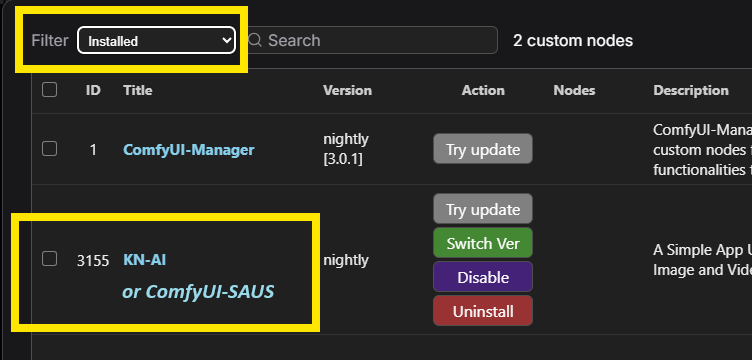
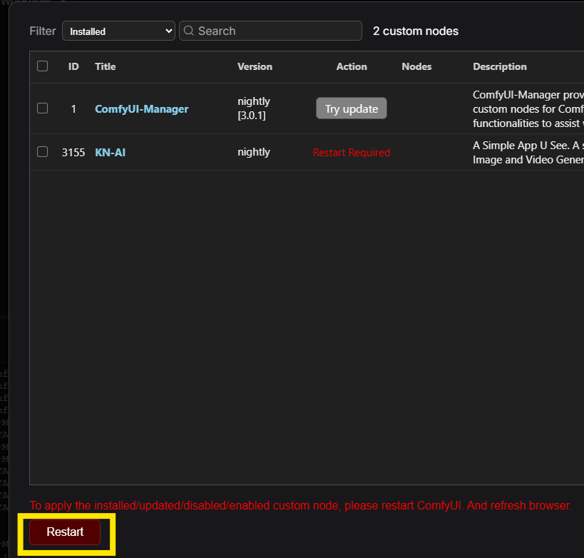
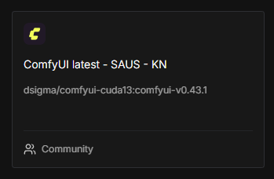

# Installation

[Return to User Guide](USER_GUIDE.md)

## Requirements - ComfyUI and ComfyUI-Manager
 - [ComfyUI](https://github.com/comfyanonymous/ComfyUI)
 - [ComfyUI-Manager](https://github.com/ltdrdata/ComfyUI-Manager)

For detailed instructions on how to install ComfyUI and ComfyUI-Manager, please refer to [ComfyUI Installation Instructions](ComfyUI_install_instructions.md).

## From ComfyUI Manager

If you already have installed [ComfyUI](https://github.com/comfyanonymous/ComfyUI) and [ComfyUI-Manager](https://github.com/ltdrdata/ComfyUI-Manager), the easiest way is to do it via the Manager.


Search for ComfyUI-SAUS, and install it.

## Manual Install

It is required that you have git installed. 

1. Navigate to the `custom_nodes` folder inside your ComfyUI installation.
2. Open a terminal (or type `cmd` in the address bar on Windows).
3. Run the following command:

```bash
git clone https://github.com/dsigmabcn/ComfyUI-SAUS.git
```
SAUS itself has no Python dependencies beyond ComfyUI (`requirements.txt` is empty). If an app asks for a node pack, add it through ComfyUI-Manager.

## Automatic Install (scripts)

To simplify installation, we provide scripts for Windows and Linux that install SAUS and the recommended custom nodes automatically.

The SAUS installers assume you already have ComfyUI and ComfyUI-Manager installed.

### Windows (Portable Version)

1. Download the **install-saus-windows.bat** script from this repository.
2. Place the file in your **ComfyUI_windows_portable** directory (the folder containing `run_nvidia_gpu.bat` and the `ComfyUI` folder).
3. Double-click `install-saus-windows.bat` to run it.

### Linux
Git needs to be installed on your system. If you do not have it:

```bash
sudo apt install git-all
```

1. Download the **install-saus-linux.sh** script from this repository.
2. Place the file in your **ComfyUI** root directory (the folder containing `custom_nodes`).
3. Open a terminal in that directory.
4. Make the script executable and run it:
   ```bash
   chmod +x install-saus-linux.sh
   ./install-saus-linux.sh
   ```

## Updating SAUS

ComfyUI-Manager lists SAUS among the installed custom nodes. Use **Try update** to pull the latest version, then **Restart** when Manager asks for it — the SAUS **Settings** tab also has a Restart button.




## Runpod - pods

Runpod offers GPU rental at a good price for running the latest image and video models, so you do not have to grind and optimise workflows yourself. After signing up, create a Network Disk (large enough for the models) and use the **ComfyUI SAUS template**.



See the [Runpod guide](RUNPOD.md) for the port to open and the first-run notes.

[Return to User Guide](USER_GUIDE.md)