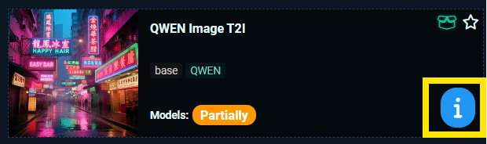
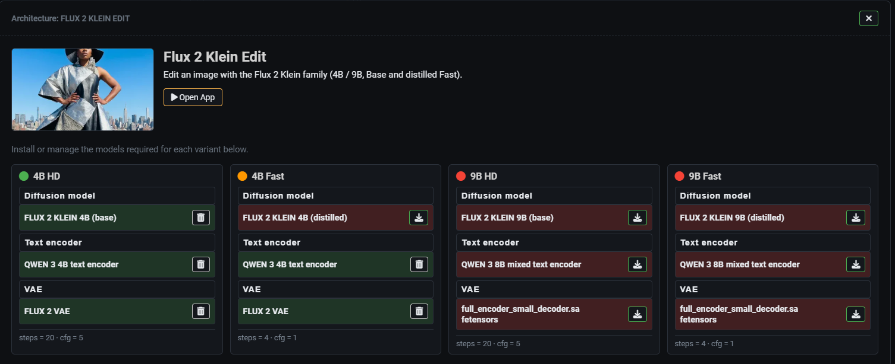

# Managing Models for Apps

[Return to User Guide](USER_GUIDE.md)

Before running a SAUS app, the required models need to be installed, somewhere inside ComfyUI's model folders.

### Where models live
**The exact folder does not matter.** SAUS looks for each model **by file name in every folder ComfyUI loads models from** (and inside any sub-folder), using ComfyUI's own folder configuration. So:

- A diffusion model counts as installed whether it is in `models/unet/` or in `models/diffusion_models/` — ComfyUI treats both as the same kind of model. The same applies to text encoders (`models/text_encoders/` or `models/clip/`), ControlNet (`models/controlnet/` or `models/t2i_adapter/`), and so on.
- Putting a model in a sub-folder is fine as well, e.g. `models/loras/sdxl/my-lora.safetensors`.

Extra model locations configured with `--models-directory`, `--base-directory` or `extra_model_paths.yaml` are searched too.

If you already have the model but with a **different file name**, you can still open the app and pick the file manually there. The folder shown for a model in the app information is only a *hint*: it is tried first when looking for the file, and it is used as the preferred download destination.

## Model Status
Every app row in the explorer carries a status dot. Apps can offer several **variants** (for example HD and Turbo), each with its own models, and the dot reports the app as a whole:

- green: every variant of the app has all of its models installed.
- orange: at least one variant is complete, but another one is not.
- red: no variant is complete yet.

A variant needs what it is built on: the models it picks (including its own distillation/lightning LoRA) are required **for that variant**, while models that no variant picks never block anything. Where the app offers several alternatives (two VAEs, for example), having any one of them is enough.

When an app has several variants, hovering the row shows one line per variant (e.g. `HD ✓`, `Turbo — 2 models missing`); with a single variant it simply lists the missing models.
For the installation, you need to access the information panel: click the information button on the row.

The information panel opens as a window over the workspace:

Some models (typically VAEs and text encoders) are used by multiple apps, so you only need to install them once. This is why you might see the 'Orange' status even if you haven't downloaded any models (for that specific app yet), as it is used for another App.

### App information
- **Title**: The title of the app.
- **Description**: A short description of the app. **May include some specific instructions, e.g., to run distillation/lightning loras.**
- **Open App**: By clicking on it, the app opens in a tab of the workspace (or use ↗ on its tab to open it in a separate window).

Even if not all models are installed, you can access the App. You can still manually select the models in the App, if for example you have already models installed in ComfyUI but are not located in the routes defined by SAUS, or have a different filename.

### Models

Below the App information, you will see a list of models, showing if the model is Installed or Missing and a button to install/uninstall them. When you click on install, the model will start downloading (you will see a progress bar)

A model being downloaded stays **red with its progress bar** — closing and reopening the panel does not make it look installed. It turns green only when the file is complete: the download is written as `<name>.part` first and renamed at the end, so a half-written model is never reported as ready (by SAUS or by ComfyUI itself). A download or a deletion shows up on **every** variant that needs that model, not just the one you clicked.

The models are shown in three groups:
- **Compulsory**: These models are strictly required to run the app.
- **At least One Required**: In some apps, we can have model versions or variants. You only need to install one of them. For example, you can choose to use the Qwen Image model (original one) or the version 2512. Obviously, you can download both and later choose the one you like in the app.
- **Optional models**: Typically distillation/lightning loras. You can run the app without them. If you use them, check out any specific instruction on which settings require (number of steps and CFG)

## Installing Models
If a model is missing, click over the 'download' icon and the model will start downloading and will be installed in a pre-defined location used by the app.

## Uninstalling Models
If you want to free up space because you no longer use an app, you can delete its models by clicking over the 'trash bin' icon to **Uninstall**.

[Return to User Guide](USER_GUIDE.md)