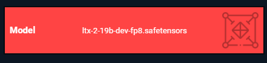

# Managing Models for Apps

[Return to User Guide](USER_GUIDE.md#installing-and-uninstalling-models)

Before running a SAUS app, the required models need to be installed, somewhere inside ComfyUI's model folders.

### Where models live
When you already have models installed, **the exact folder does not matter**, because SAUS looks for each model **by file name in every folder ComfyUI loads models from** (and inside any sub-folder), using ComfyUI's own folder configuration. So:

- A diffusion model counts as installed whether it is in `models/unet/` or in `models/diffusion_models/` — ComfyUI treats both as the same kind of model. The same applies to text encoders (`models/text_encoders/` or `models/clip/`), ControlNet (`models/controlnet/` or `models/t2i_adapter/`), and so on.
- Putting a model in a sub-folder is fine as well, e.g. `models/loras/sdxl/my-lora.safetensors`.

Extra model locations configured with `--models-directory`, `--base-directory` or `extra_model_paths.yaml` are searched too.

For the model files to be recognized, **they need to have the exact name set in the ComfyUI templates**. If you already have the model but under a **different file name, you can still open the app** and select the file manually under **Advanced Options**.

## Model Status
Every app row in the explorer carries a status dot. Apps can offer several **variants** (for example HD and Turbo), each with its own models, and the dot reports the app as a whole:

- green: every variant of the app has all of its models installed.
- orange: at least one variant is complete, but another one is not.
- red: no variant is complete yet.

A variant needs what it is built on: the models it picks (including its own distillation/lightning LoRA) are required **for that variant**, while models that no variant picks never block anything. Where the app offers several alternatives — a VAE, a sampler, a family of interpolation models — **one of that group** is enough, and a group is a group: an app that needs an interpolation model *and* an upscaler is not complete with only one of the two.

The dot on a **variant card** in the information panel is computed by the same rule as the dot on the app row (`web/saus_browser/js/variantStatus.js`), so the two never disagree — a card is not orange for an alternative it does not need, and an uninstalled *optional* model never colours anything.

When an app has several variants, hovering the row shows one line per variant (e.g. `HD ✓`, `Turbo — 2 models missing`); with a single variant it simply lists the missing models.
To install models, open the information panel: click the **(i)** button on the row.

The information panel opens as a window over the workspace:

Some models (typically VAEs and text encoders) are used by multiple apps, so you only need to install them once. This is why you might see the 'Orange' status even if you haven't downloaded any models for that specific app yet — another app already uses one of its shared models.

### App information
- **Title**: The title of the app.
- **Description**: A short description of the app. **May include some specific instructions, e.g., to run distillation/lightning loras.**
- **Open App**: By clicking on it, the app opens in a tab of the workspace.

Even if not all models are installed, you can open the app and pick the models by hand there — for example if you already have them in ComfyUI but in a folder SAUS does not look in, or under a different file name.

### Models

Below the App information, you will see a list of models, showing if the model is Installed or Missing and a button to install/uninstall them. When you click on install, the model will start downloading (you will see a progress bar)

The models are grouped **one card per variant**, and each card's title carries a **Download All** button: one
click starts every model that variant still needs. Optional models are never downloaded for you, a model
that is already downloading is not started twice, and a variant whose models are all there shows
**All installed** instead of the button.

An app whose architecture has **no variants** — a single choice, such as one upscaler, one pose detector or
one interpolation model — shows a single **Base** card listing the files it can use. Any one file of a
"one of" group is enough, and when the app opens it binds the first *installed* one (falling back to the
first declared, which is what the app ships with).

Where a tool's whole choice is the model, the architecture offers **one variant per model** instead
(the upscale apps: ESRGAN x2 / x4, UltraSharp x4, AnimeSharp x4; the frame-interpolation tools: FILM net
or RIFE 4.26; the SeedVR2 upscalers: 3B or 7B). Pick one from the row of buttons in the app — Custom is
still there if you want to choose a file yourself. Installing one of those therefore shows the **app row**
as orange (one variant complete, the others not) while the app itself runs
perfectly: the dot is telling you which models are still installable, and the information panel shows it
per variant.

## Installing Models
If a model is missing, click over the 'download' icon and the model will start downloading and will be installed in a pre-defined location used by the app.

## Uninstalling Models
If you want to free up space because you no longer use an app, you can delete its models by clicking over the 'trash bin' icon to **Uninstall**.

## The Model Manager

**Settings → Managers → Model Manager** opens the other half in its own tab: every model the registry
knows, not just the ones one app needs.

- The list is **grouped by model kind** — one boxed section per kind, the way the App Manager files its
  subcategories — and inside each, cards in **flexible columns** as wide as the side panel. Each card is
  the model — its name, with its **Install / Uninstall** state top right — and under a divider, **the
  apps that need it**: each app as its own thumbnail plus name, with the rest counted (`+3`). Hovering an
  app shows its category. Only the top band carries the red / green state; the app list sits on the page
  background. (The folder a model belongs in is not shown: SAUS finds it by file name anywhere.)
- Two chip rows filter the list: **All / Installed / Not installed / Unused**, and a chip per **model
  kind** (Diffusion model, VAE, TEXT ENCODER, LORA, …) with its count. **Unused** finds files no app
  *and* no architecture references any more — architectures are counted for that answer, but the cards
  themselves only name apps.
- **Install** and **Uninstall** work exactly as they do in the app's **(i)** panel, and share the same
  progress: starting a download in one view shows up in the other, and both write to the same ComfyUI
  model folders.

Uninstalling still only ever touches model weight folders (`custom_nodes` and `datasets` are never
touched), and it asks before deleting.

[Return to User Guide](USER_GUIDE.md#installing-and-uninstalling-models)