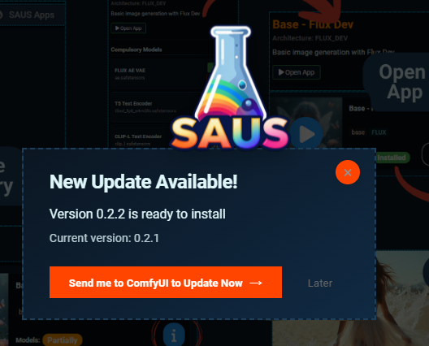

# General Navigation

[Return to User Guide](USER_GUIDE.md)

On the SAUS landing page, you can identify these main elements:

## Icon rail and explorer
The far-left rail is always visible (with the SAUS logo on top). The three icons below it are the sections of Apps (AI Image, AI Video, Other): **click** one to open the explorer panel on that section, click it again to close it, and **hover** another one to switch the open panel to it. At the bottom of the rail are the tools: **ComfyUI** (new window), **Files** ([File Manager](FILE_MANAGER.md), as a tab), **Guide** (this guide), **Console** (the ComfyUI log feed, as a tab) and **Settings** (as a tab).

The panel is only shown when you open it (Esc closes it), and it remembers the section and the subcategories you had unfolded.
Check out: [App Browsing](APP_BROWSING.md)

## Project links
There is no header or footer: the SAUS logo is at the top of the rail, and the links to the project (ko-fi, GitHub, YouTube) plus the installed version are at the bottom of the **Settings** tab.

## Main Container:
In this section of the screen the apps you opened from the explorer are loaded, each one as a **tab**, so you can jump between several apps without leaving the page. Settings, the File Manager and the Console open here as tabs too. A tab can be **enlarged** to use the whole browser area, or closed with its ✕.

## Updates:
If a newer version of the software is available, the 'updates' icon will appear. Click on it if you want to update it.

Click on 'Send me to ComfyUI to Update Now'. Currently, updates must be done via the ComfyUI Manager. When you click this, you will be taken to the ComfyUI graph. To access the manager, click the 'Manager' icon in the action bar on the top right.

ComfyUI Manager will pop up. Access the Custom Nodes Manager:

A list of all available custom nodes for ComfyUI will appear. Now, filter by installed custom nodes:

Search for 'SAUS' (the full name is ComfyUI-SAUS).

Then, click 'Try Update', and the node will begin updating from GitHub.

When the update is complete, you must restart ComfyUI. You will see a 'Restart' button appear at the bottom of the manager.

After ComfyUI has restarted, refresh your browser (F5) and click the SAUS button again.

[Return to User Guide](USER_GUIDE.md)
