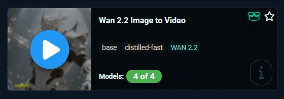
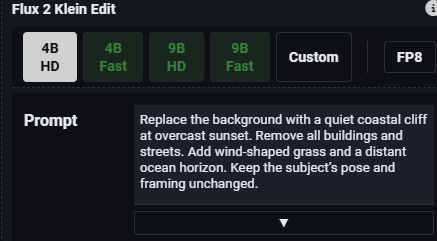
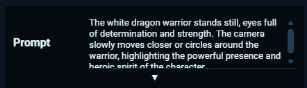
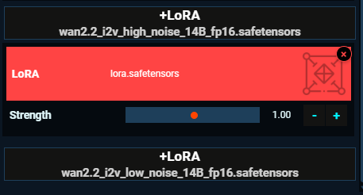
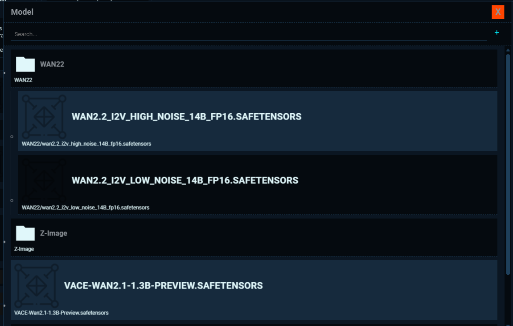
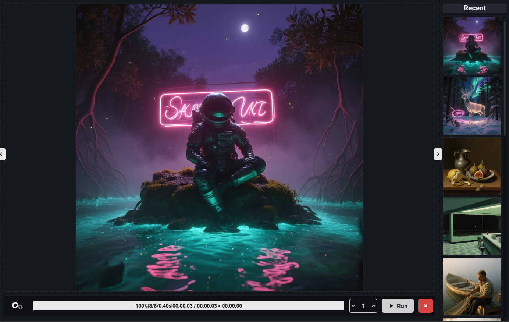

# Running an App

[Return to User Guide](USER_GUIDE.md)

## Open an App
After you have installed all models needed for an app, open it by clicking on its row.

## Configure Parameters - Basic

Next to the app's **name** sits an **(i)** that opens the [information panel](MODELS.md), where you can install or uninstall the required models for the app.

Just below are the app's **modes**: **HD** is what the app runs as by default and
**Custom** always stays (it exposes the parameters as they are). Any other button comes
from the app's architecture — **Turbo** only appears where that architecture defines it,
and named variants replace the HD / Turbo pair completely. A mode whose models are not
installed is greyed out; hover it to see which file it is missing.

Below that, you can adjust the basic controls for an app/workflow. Not all controls are available for all apps, but here we comment the most common ones.

### Prompt
In the prompt box you describe the image or video that you want to generate.

You can enlarge the prompt text box by clicking on the triangle below the text box.

For newer models (e.g. KREA-2, Minimax H3), the workflow sometimes includes a **prompt rewrite** toggle. When active, your prompt is rewritten by an LLM so the diffusion model follows the training instructions better, which generally results in better adherence to the prompt.

### Image/Video Resolution and dimensions

Depending on the app:
- Choose aspect ratio and resolution (in megapixels)
- Predefined dimensions layout (Square, landscape, portrait, custom)
- Width and height
- None (for image editing, normally)

### Duration (s)

For video generation, the length of the clip that we want to generate. 

### Seed

The seed determines the starting random noise for the video or image generation. It is displayed at the bottom and can be changed as you want, by typing the desired seed number or by using the `+` or `-` buttons.

By default, the seed is random and it changes after you run the image/video generation. Next to the number is the **'R'** (randomizer) button. 
- Click on it to generate a random number.
- Click and hold for a couple of seconds to convert your seed from random to fixed. When fixed, your seed will not change after you run the generation. - Click and hold again to convert it back to random.

### Steps ###

You can define here the number of steps for the KSampler (steps for the diffusion/checkpoint model) to generate the image. In general, more steps, more detailed images.

For video generation, steps are generally under **Advanced**

### Save Filename - Filename prefix

Indicate here the prefix of the filename of your results saved in the output folder.

### Lora
At the bottom, you will see an **Add Lora+** button, which lets you use LoRAs.

When you click it, a new LoRA block appears: the LoRA dropdown, with the **strength** control below.

As with model loading, just click on the dropdown, and a pop-up window listing your LoRA folder will appear. Navigate and select the LoRA you want to use. If the app accepts distillation LoRAs, they will appear here.

Below the lora model, you have the strength slider, where you can set the strength between 0 and 2 (default is 1, typically in the range of 0.5-1).

To add another LoRA, click **Add Lora+** again; use the **✕** in the corner of a block to remove it.

> [!NOTE]
> As for the models, the Wan 2.2 app has 2 lora buttons that can be used for the Lightxv2 models. The first one corresponds to the first model (high), and the second for the second model (low).

### Image (Video) Loader
For Image-to-image or image-to-video apps, you will need to use a reference image, which can be loaded into the 'input' folder of ComfyUI:

You can add an image by:
- Drag and drop an image over the image space
- Double clicking over the image space
- Click over 'Image Loader' to open the 'input' folder and select the image you want to use

After dropping the image or selecting it from local or input folder, the image will be loaded and ready to be used in the app for transformation, editing or as reference.

### Masking (inpainting apps)

Inpainting apps let you draw a mask over the reference image to choose what gets regenerated. The **Mask Settings** panel holds the brush size, the mask colour, the brush/erase tools, whether the mask is hidden or resized, and the mask size, blur and save mode.

## Advanced Controls

The Advanced controls are hidden behind a **Show Advanced** fold at the bottom of the control panel (below the LoRA list): click it to reveal the advanced settings, and **Show less** to fold them back.

The available controls will depend on the app you are running, but some common ones are:

- **Model**: if you want to use a different model than the one provided in the variants, you can choose the one you prefer.

- **CLIP and VAE**: if you want to use different text encoder or VAE models, you can select them here.
- **Sampler and scheduler**: you can change the sampler and scheduler for the diffusion process here.
- **Number of steps and CFG**: in the advanced settings, you can also change the number of steps for the diffusion process and the Classifier-Free Guidance (CFG) value. In general, the default values are good, but if you are going to use **distilled or lightning LoRAs**, you will need to change them, normally by **reducing the steps to 4-8** (depending on the LoRA) and the **CFG to 1**.

## Generate (image or video)

**Run**, the number of runs and the **✕** cancel button sit **inline next to the progress bar**. When your basic settings are defined, click **Run** to start generating. Change the number of runs first if you want the workflow queued several times.

The small rotating gears will start rotating, and the **number of queued runs left** appears right below the gears. Next to the progress bar you can see which nodes are being processed in the ComfyUI background. When the sampler starts, you will also see the progress bar progressing with the number of steps.

More detailed logs can be accessed via the **Console** at the bottom of the SAUS rail. This is useful when a model takes too long, or for troubleshooting.

If you want to stop the generation process, just click the **✕** next to the progress bar, and the sampling will stop.

## Image visualization and Recent images

When the image or video generation process is finished, you can see the results:

The images or videos can be seen here and can also be downloaded by right-clicking and selecting 'Save As'. All images and videos are saved in the 'output' folder of ComfyUI, which you can access with the File Manager.

On the right, there is the 'Recent' panel, which shows the images that have been generated in the current session. You can navigate and open them to compare with the latest generation. The 'Recent' panel will not show generated images from previous sessions, so to see them you will need to access the File Manager.

[Return to User Guide](USER_GUIDE.md)