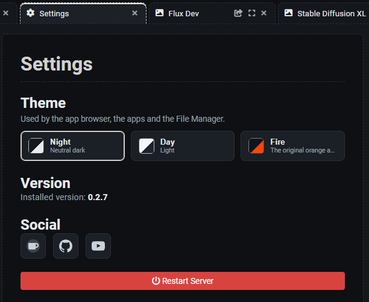

# Settings

[Return to User Guide](USER_GUIDE.md#settings)

## Theme

Pick the look of the whole UI here: the app browser, the apps it opens and the File Manager all
follow it.

| Theme | What it is |
| --- | --- |
| **Night** | Neutral dark: greys and white, no colour accent. **The default.** |
| **Day** | Light: a pale blue-grey canvas and panels, with **white** cards, modals and inputs so they still stand out. Dark text. |
| **Fire** | The original SAUS look: orange and ice on midnight blue. |

## Apps

**Show deprecated apps** — when a newer model supersedes an older one, the older apps are moved to a
`deprecated` folder inside `web/apps` and left out of the side panel, so the panel only offers what
is current. Switch this on to list them again: they open and run exactly as before, which is what you
want for an older workflow or a project already built on them. The setting is remembered per browser.
It also decides whether deprecated apps appear in the **App Manager** below — while it is off they
are not listed there either, so this switch is what you turn on to manage them.

**Remember app settings in this session** — on by default. While it is on, an app you close (or a
page you reload) comes back as you left it: its settings, prompt, version, LoRAs and recent results.
The memory lives in the browser tab, so it disappears when you close the browser, and a ComfyUI
restart also starts a fresh session. Switch it off to make every re-opened app start from its
defaults instead.

## Managers

Two buttons, each opening a view in its own workspace tab (like the settings themselves):

- **App Manager** — every app the panel may offer, grouped by section and category, with a switch per
  app that hides or shows it. See [App Browsing](APP_BROWSING.md#hiding-apps).
- **Model Manager** — every model the apps need, with what is installed and which apps use it.

Hiding an app is an install-wide setting (it is stored on the server, not in your browser), so every
device that opens this ComfyUI sees the same panel.

## Version

The installed SAUS version (the same number the update check compares against the latest release).

## Social

Links to the project, as icons: **ko-fi** (support), **GitHub** (code, issues, releases) and
**YouTube** (videos).

## Restart Server
- Restart the ComfyUI server directly from the UI (e.g. after updating custom nodes with ComfyUI-Manager).

[Return to User Guide](USER_GUIDE.md#settings)